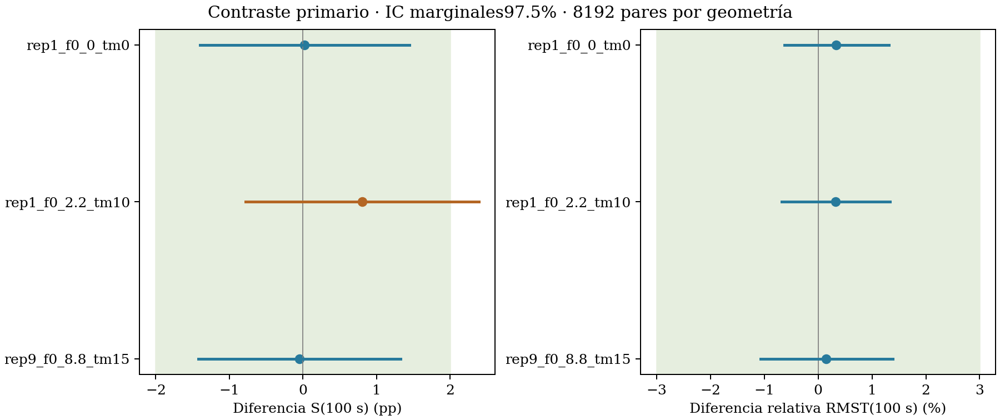
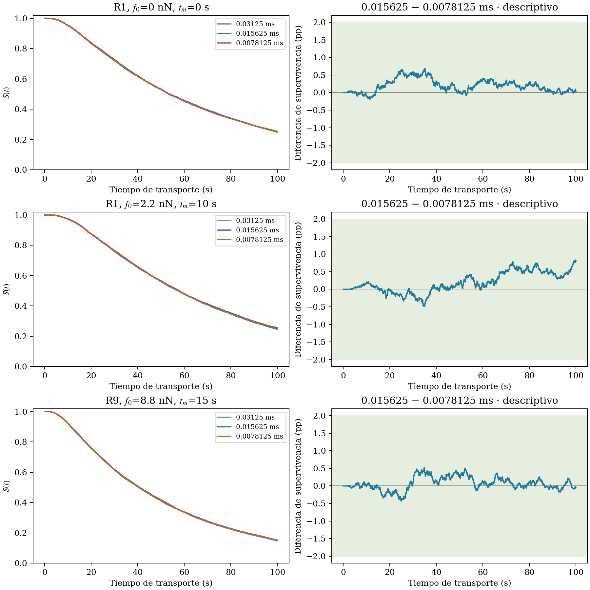

# Prueba temporal confirmatoria del transporte

Informe original del 9 de octubre, bajo el criterio de ±2 pp. La
[revisión posterior a ±2.5 pp](../temporal_20261012_revision/informe_revisado.md)
se documenta por separado y no sustituye la decisión original que sigue abajo.

## Conclusión

**No se demuestra equivalencia conjunta en todas las geometrías comprobadas.** No corresponde marcar la convergencia temporal completa como aprobada ni ampliar los márgenes para conseguirlo.

Se completaron73728 trayectorias:8192 posiciones por geometría,3 geometrías y3 pasos. No se repitió la mecánica, no se modificó la producción y no hubo análisis de resultados intermedios.

## Resultados

| Estado | Paso (ms) | Escapan | Censurados | S(100 s) | RMST(100 s) |
|---|---:|---:|---:|---:|---:|
| rep1_f0_0_tm0 | 0.03125 | 6117 | 2075 | 25.33% | 57.748 s |
| rep1_f0_0_tm0 | 0.015625 | 6145 | 2047 | 24.99% | 57.737 s |
| rep1_f0_0_tm0 | 0.0078125 | 6147 | 2045 | 24.96% | 57.543 s |
| rep1_f0_2.2_tm10 | 0.03125 | 6099 | 2093 | 25.55% | 59.998 s |
| rep1_f0_2.2_tm10 | 0.015625 | 6110 | 2082 | 25.42% | 59.983 s |
| rep1_f0_2.2_tm10 | 0.0078125 | 6176 | 2016 | 24.61% | 59.793 s |
| rep9_f0_8.8_tm15 | 0.03125 | 6982 | 1210 | 14.77% | 48.082 s |
| rep9_f0_8.8_tm15 | 0.015625 | 6944 | 1248 | 15.23% | 48.307 s |
| rep9_f0_8.8_tm15 | 0.0078125 | 6940 | 1252 | 15.28% | 48.235 s |

## Contraste primario:0.015625 menos0.0078125ms

| Estado | ΔS e IC (pp) | Decisión S | ΔRMST relativo e IC (%) | Decisión RMST |
|---|---:|---|---:|---|
| rep1_f0_0_tm0 | 0.024 [-1.398, 1.447] | Cumple | 0.338 [-0.629, 1.317] | Cumple |
| rep1_f0_2.2_tm10 | 0.806 [-0.782, 2.392] | Inconcluso | 0.318 [-0.682, 1.339] | Cumple |
| rep9_f0_8.8_tm15 | -0.049 [-1.424, 1.326] | Cumple | 0.149 [-1.067, 1.385] | Cumple |

Los márgenes permanecen ±2pp y ±3%. Se conservó el procedimiento conservador del piloto anterior: cotas exactas para discordancias y bootstrap pareado de20000 remuestreos. Los IC son condicionales a cada geometría; no miden la variación entre redes. La cobertura bootstrap es aproximada.

## Contraste diagnóstico:0.03125 menos0.015625ms

| Estado | ΔS e IC (pp) | ΔRMST relativo e IC (%) | Conjunto |
|---|---:|---:|---|
| rep1_f0_0_tm0 | 0.342 [-1.199, 1.883] | 0.018 [-1.036, 1.097] | Cumple |
| rep1_f0_2.2_tm10 | 0.134 [-1.541, 1.810] | 0.023 [-1.052, 1.102] | Cumple |
| rep9_f0_8.8_tm15 | -0.464 [-1.903, 0.975] | -0.467 [-1.763, 0.854] | Cumple |

## Supervivencia

Las curvas y las bandas±2pp son descriptivas. La prueba fijada corresponde a los indicadores a100s, no a equivalencia uniforme en todo el intervalo.

## Qué no concluye esta prueba

- No valida el número de plaquetas, la estereología ni la calibración del tiempo mecánico.
- No demuestra convergencia espacial o conectividad completa.
- No certifica las117 geometrías de producción ni otros radios, D, fronteras o redes móviles.
- Si un intervalo cruza el margen, el resultado es inconcluso, no automáticamente incorrecto. Si queda completamente fuera, es evidencia de una diferencia relevante bajo el criterio fijado.
- Si el paso actual no cumple, el paso más fino no queda por ello validado; necesitaría una referencia adicional.

## Integridad

Hashes de fuentes y geometrías verificados; replays del ejecutor histórico idénticos en todos los campos; acoplamiento browniano contrastado en espacio libre; errores numéricos nunca convertidos en censura. Geometrías de producción y minipaper intactos.

Protocolo completo: [protocolo.md](protocolo.md). Resultados y contadores: `results.json`; registros por trayectoria y bloques originales conservados.
